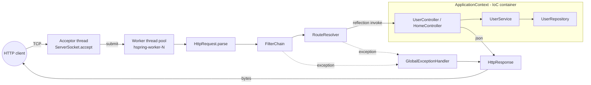
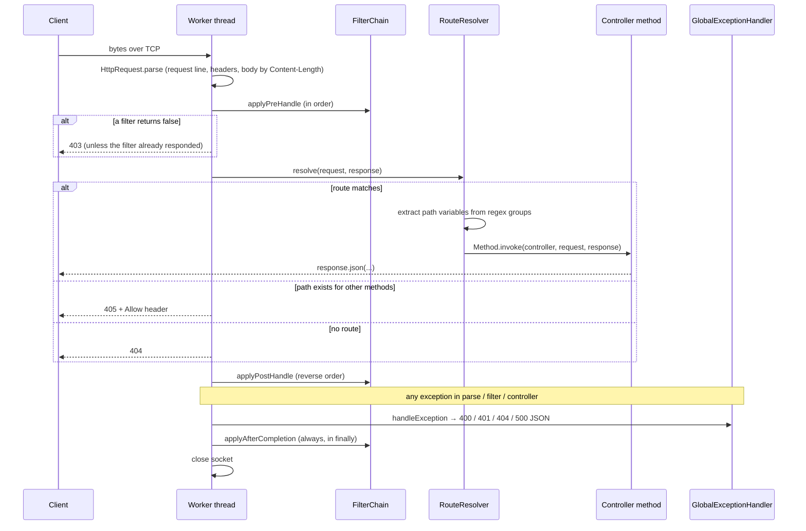

# 1. Architecture Overview

## What the project is

HSpring re-implements the core ideas of Spring Boot so you can **read and step through them**:

- An **IoC container** that discovers classes by annotation, creates them, and wires them together.
- A **web layer** that maps HTTP requests to controller methods using annotations.
- An **embedded HTTP server** that accepts TCP connections and processes requests on a thread pool.
- **Cross-cutting concerns**: a filter chain and a global exception handler.

It ships with a small demo app: a user CRUD REST API (`/api/users`), a home page (`/`) and a health check (`/health`).

## Package layout

```
com.project.MultiThreadedWebServer
├── Application.java            Main class: @SpringBootApplication + main()
├── WebServer.java              Embedded server only (like Tomcat): sockets, thread pool, request lifecycle
├── Client.java                 Raw-socket demo client that exercises every endpoint
│
├── annotations/                The "metadata" the framework reads with reflection
│   ├── SpringBootApplication                  → "this is the main class; scan from here"
│   ├── Component, Service, RestController     → "manage this class as a bean"
│   ├── Configuration, Bean                    → "this method produces a bean"
│   ├── Autowired, Qualifier                   → "inject a dependency here (by type / by name)"
│   ├── Value                                  → "inject a property from application.properties"
│   ├── PostConstruct, PreDestroy              → lifecycle callbacks
│   └── GetMapping, PostMapping, PutMapping, DeleteMapping → routing
│
├── core/                       The framework engine
│   ├── HSpringApplication      Bootstrap orchestrator (like SpringApplication.run())
│   ├── ApplicationContext      IoC container (scan → create → @Value → inject → init)
│   ├── PropertiesLoader        application.properties + args/system/env overrides
│   ├── BeanCreationException   Startup failures (missing/ambiguous/circular deps)
│   ├── RouteResolver           URL pattern → controller method dispatch + return-value serialization
│   ├── ResponseEntity          Status + headers + body returned by controllers
│   ├── HttpRequest             Parses raw bytes into method/path/headers/body
│   └── HttpResponse            Builds and writes the HTTP response bytes
│
├── filter/                     Request interceptors
│   ├── Filter                  preHandle / postHandle / afterCompletion
│   ├── FilterChain             Runs filters in order (and reverse order on the way out)
│   └── LoggingFilter           Logs each request and its duration
│
├── exception/                  Centralized error handling
│   ├── GlobalExceptionHandler  Exception type → HTTP status + JSON body
│   └── NotFoundException, ValidationException, UnauthorizedException
│
└── (demo application)
    ├── config/                 AppConfig         (@Bean ObjectMapper)
    ├── controller/             HomeController, UserController
    ├── service/                UserService       (business logic)
    ├── repository/             UserRepository    (thread-safe in-memory storage)
    └── model/                  User              (immutable record)
```

The **framework** (`annotations`, `core`, `filter`, `exception`, `WebServer`) knows nothing about users.
The **demo app** (`config`, `controller`, `service`, `repository`, `model`) is discovered at runtime by component scanning,
exactly as your classes are discovered by Spring Boot.

## Component diagram



## Startup sequence

What happens when you run `java -jar target/hspring-framework-1.1.0.jar`:

```mermaid
sequenceDiagram
    participant Main as Application.main
    participant App as HSpringApplication.run
    participant Ctx as ApplicationContext
    participant RR as RouteResolver
    participant WS as WebServer

    Main->>App: run(Application.class, args)
    App->>App: read @SpringBootApplication → base package
    App->>App: load properties (--args → -D property → env var → application.properties)
    App->>Ctx: new ApplicationContext(properties, "com.project.MultiThreadedWebServer")
    Ctx->>Ctx: 1. scan classpath (directories and JARs) for .class files
    Ctx->>Ctx: 2. create beans, constructor-injecting dependencies first (recursive); call @Bean methods
    Ctx->>Ctx: 3. inject @Value fields
    Ctx->>Ctx: 4. inject @Autowired fields (@Qualifier → by name)
    Ctx->>Ctx: 5. call @PostConstruct methods (UserService seeds 3 users)
    App->>RR: setObjectMapper(@Bean ObjectMapper), registerController(each @RestController)
    RR->>RR: read @GetMapping etc., compile each path to a regex
    App->>App: create FilterChain (LoggingFilter) and GlobalExceptionHandler
    App->>WS: new WebServer(router, filters, handler, port, threads)
    App->>App: register JVM shutdown hook (graceful stop)
    App->>WS: start(): bind port, start "hspring-acceptor" thread
    App-->>Main: return (the non-daemon acceptor thread keeps the JVM alive)
```

The startup log shows each step:

```
Found 20 classes to analyze
  ✓ Registered @RestController: HomeController
  ✓ Registered @RestController: UserController
  ✓ Registered @Component: UserRepository as 'userRepository'
  ✓ Registered @Service: UserService as 'userService' (constructor-injected 1 dependencies)
  ✓ Registered @Bean: ObjectMapper → objectMapper()
  → @Value("user.default-role") = "USER" → UserService.defaultRole
  → Injected UserService into UserController.userService
  → Injected ObjectMapper into UserController.objectMapper
  ⚙ Called @PostConstruct UserService.loadSampleData()
ApplicationContext ready with 6 beans
  GET /api/users/{id} → UserController.getUserById()
  ...
```

## Request lifecycle



## Key design decisions

| Decision | Why |
|---|---|
| **Annotations + reflection** for wiring and routing | It's how Spring works; you see the mechanism instead of the magic |
| **Fixed thread pool**, one request per connection (`Connection: close`) | Simple and predictable; mirrors Tomcat's blocking connector model |
| **Separate acceptor thread** + `start()`/`run()` split | Lets tests start a real server on port 0 and stop it |
| **Byte-level HTTP parsing in UTF-8** | `Content-Length` counts bytes; reading characters breaks on non-ASCII bodies |
| **Exceptions flow to one handler** | Controllers stay clean; consistent error JSON |
| **Fail-fast container** (`BeanCreationException`) | A broken wiring stops startup instead of failing on the first request |
| **Immutable `User` record + atomic map operations** | Many worker threads share the same data |

## What is intentionally *not* implemented

Knowing the limits is part of understanding the design (and a common interview follow-up):

- HTTP keep-alive, chunked transfer encoding, HTTPS, HTTP/2.
- Bean scopes other than singleton; `@Qualifier`/`@Primary`; AOP proxies; `@Transactional`.
- Argument resolution (`@PathVariable`, `@RequestBody` parameters): handlers receive `HttpRequest`/`HttpResponse` instead.
- Externalized configuration files (`application.properties`); only port/thread count are configurable.
- Real persistence; `UserRepository` is in-memory.

See [Interview guide → "What would you improve?"](08-interview-guide.md#what-would-you-improve-next) for how you'd add each one.
